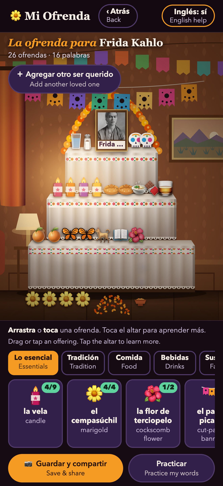
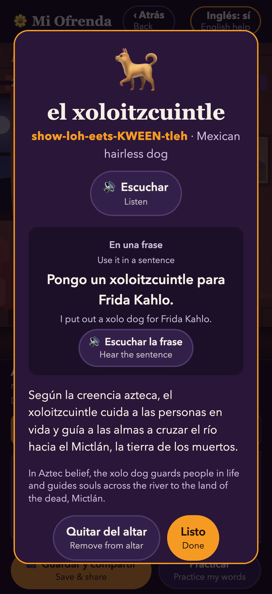
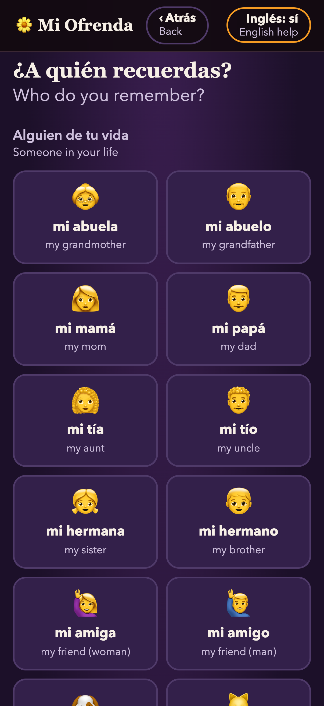
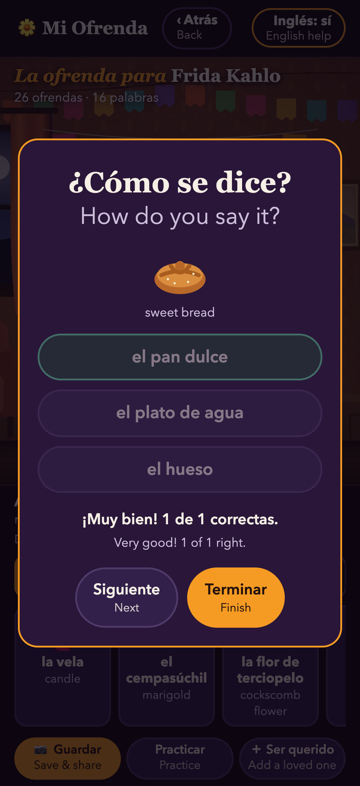

# Mi Ofrenda

**▶ Try it: [bri-an-pmp.github.io/mi-ofrenda](https://bri-an-pmp.github.io/mi-ofrenda/)**

Build a Día de los Muertos altar for someone you love and learn Spanish. Everything is in Spanish first, with English underneath as a reference (it can be switched off with the "Inglés" button).

1. Choose who to remember: a family member, a friend, a pet, or a well-known person.
2. Drag offerings onto the altar (or tap them). They fall onto the step below where you let go; drag one out of the room to take it off. Candles light up the dark room.
3. Each offering shows its Spanish word, how to say it (and says it aloud), a sentence using it with the person's name, and why it belongs on an ofrenda.
4. Add a photo of the person to the frame (it stays on the device, shrunk and without camera location data).
5. Save or share the altar as a picture: Publicación 4:5 (1080×1350), Historia 9:16 (1080×1920) or Cuadrada 1:1 (1080×1080), as JPG or PNG. On phones, Compartir opens the share menu (Instagram, WhatsApp, Facebook, TikTok, Messages, Mail, Save Image).
6. Practice the words you placed with a short quiz.

Altars are saved only on this device (in the browser, or inside the iPhone app).

## iPhone app

**Status: on the App Store.** [Download Mi Ofrenda for iPhone](https://apps.apple.com/us/app/mi-ofrenda/id6824747905) (version 1.0, build 6, tag `v1.0-build6`; submitted October 20, 2026). It is free, iPhone only, and Spanish (Mexico) first. It is the same game as the website, with a few iPhone extras: the altar picture goes straight to the share sheet ("Save Image" puts it in Photos), a light tap is felt when an offering lands, sound plays even with the silent switch on, everything works offline, and saved altars are also kept in the app's own files. People still living are left out of the app version.

<p>
  
  
  
  
</p>

<a href="https://apps.apple.com/us/app/mi-ofrenda/id6824747905"></a>

Scan with an iPhone camera to open it in the App Store.

Privacy policy: [privacidad.html](https://bri-an-pmp.github.io/mi-ofrenda/privacidad.html) · Help and contact: [ayuda.html](https://bri-an-pmp.github.io/mi-ofrenda/ayuda.html)

## Run it

- Node 22 (`nvm use 22`), then `npm install`.
- `npm run dev` starts it locally.
- `npm run build` writes the website to `dist/`.

## Real voice recordings

The app plays recorded clips from `public/audio/words/` and `public/audio/sentences/` when they exist, and uses the device's built-in voice when they don't. Each sentence clip says the sentence without the person's name ("Le enciendo una vela."), because names are typed by the user; the device voice then adds the ending with the name ("a Rosa").

To make the clips with ElevenLabs:

1. Make a file named `.env` in this folder (it is never uploaded) with two lines:
   ```
   ELEVENLABS_API_KEY=your key
   ELEVENLABS_VOICE_ID=the voice ID
   ```
2. Run `npm run voice` (needs Node 22: `nvm use 22`). It makes only the clips that are missing. `npm run voice -- --all` remakes all of them after changing the voice.

To record a real person instead, run `npm run voice -- --list` to see every file name and what it should say.

## iPhone app

The same code runs as an iPhone app with Capacitor (bundle ID `com.brianathey.miofrenda`, iPhone only).

- `npm run ios` builds the app version (`vite build --mode app`, which leaves out people still living) and copies it into `ios/App`.
- Sign and upload with Apple's cloud signing (no local keychain needed): archive with `CODE_SIGNING_ALLOWED=NO`, then `xcodebuild -exportArchive -allowProvisioningUpdates` with `method` `app-store-connect`, `signingStyle` `automatic`, team `HR3HH7NX4H`. Raise the build number (`CURRENT_PROJECT_VERSION`) for every upload.
- App-only features live in `src/native.js`: a file copy of saved altars, a light haptic when an offering lands, and the iPhone share sheet.
- Store text, screenshots and review notes: `docs/app-store/`. Privacy and help pages: `public/privacidad.html`, `public/ayuda.html`.

## Code map

- `index.html`: the three screens (welcome, choose a person, altar), the word card and the quiz.
- `src/data.js`: all content. Offerings, people, pets and famous figures. Add a new offering here.
- `src/main.js`: how it works (drag and drop, candlelight, photos, saving, sharing, speech, quiz).
- `src/snapshot.js`: draws the altar as a picture for saving and sharing.
- `scripts/make-voice.mjs`: makes the voice clips with ElevenLabs.
- `src/style.css`: the look.
- `vite.config.js`: adds the security policy to the built page.
